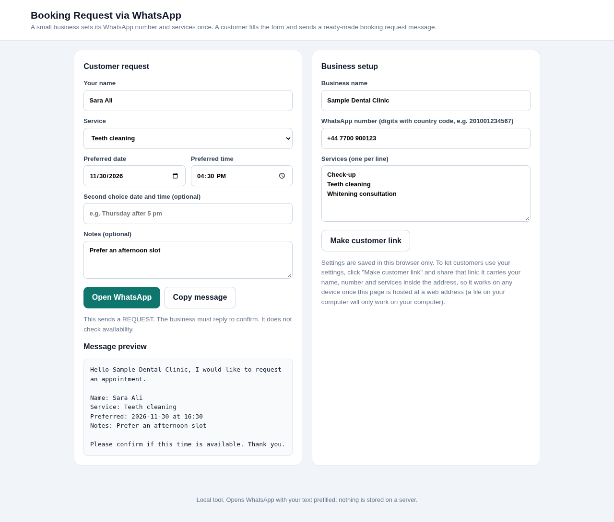

# Booking Request via WhatsApp

_Screenshot of the tool with sample data entered through the page (fictional names and numbers)._

A small business sets its WhatsApp number and services once. A customer fills the form and opens WhatsApp with a ready-made booking request message.

## What it does
- Builds a wa.me link with name, service, preferred date and time, optional second choice and notes
- Validates name, date (not in the past) and the business number
- Copy message button and live message preview
- "Make customer link": a link that carries the business name, number and services in the address (after the #), so customers on other devices see your settings. Tested in a fresh browser origin with empty storage. The page must be hosted at a web address for others to open it; a local file only works on your own computer. Invalid or tampered links are ignored
- It sends a request only: the business must reply to confirm, and availability is not checked
- Your settings are saved in your own browser

## Run it
Open `index.html` in a browser. The business number starts empty and the Open WhatsApp button stays disabled until a valid number is entered in Business setup. The screenshot uses +44 7700 900123, a number in the range Ofcom reserves for TV and radio drama (https://www.ofcom.org.uk/phones-and-broadband/phone-numbers/numbers-for-drama). Nothing is sent until the customer taps Open WhatsApp and presses send inside WhatsApp. No install, no build, no server, no account.

## Tests and limits
- Browser-tested in headless Chrome: 23 checks passed on the current code (they include a mobile layout check, which only proves nothing overflows).
- Data stays in this browser. Clearing site data deletes it. No sync between devices.
- Plain HTML, CSS and JavaScript, no frameworks.

Built by Mahamed Yasser.
